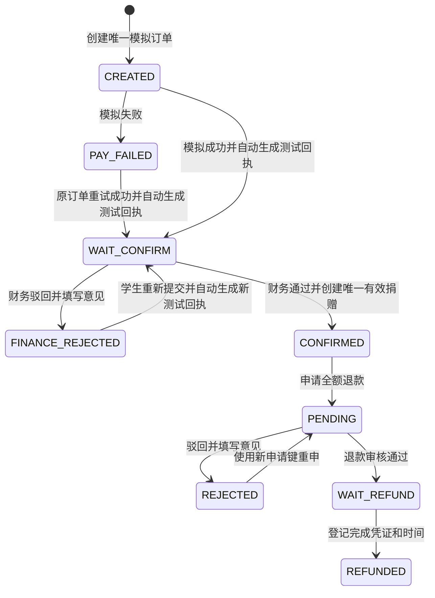
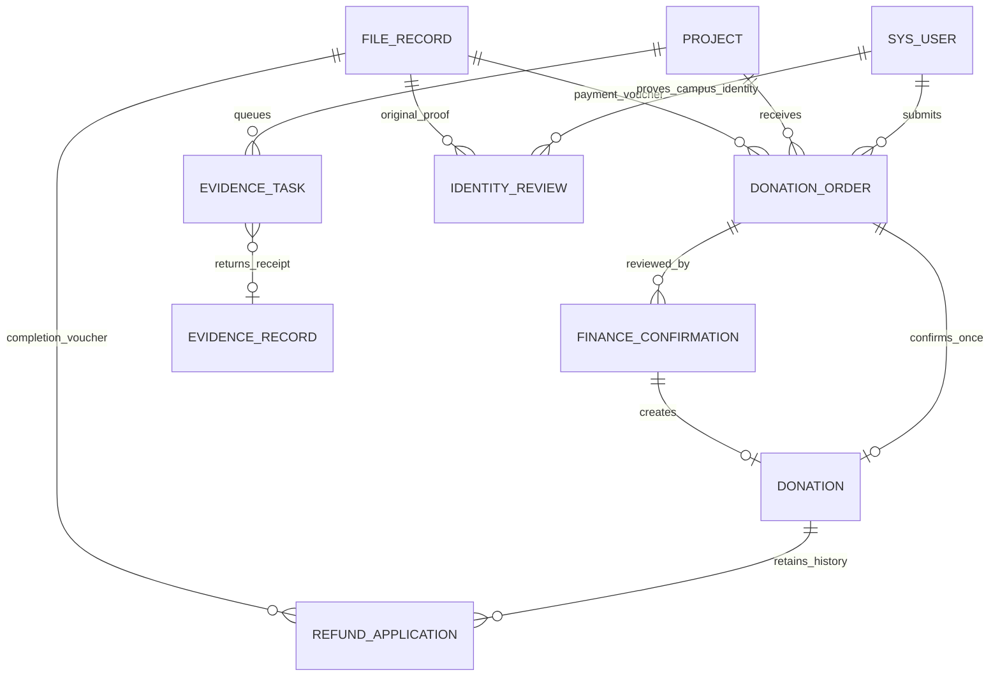

# 新版财务流程与接口

2026-10-17，依据更新后的第10组系统文档。学校管理是一个业务类别，兼容的技术权限代码为 ADMIN（审核、财务、管理）和 AUDITOR（监督查询、规则、报告，无财务写权限）。用户身份始终从服务端解析的 JWT 获取，客户端不能指定捐赠人或经办人冒用他人身份。

## 状态和金额



上图中 CREATED～CONFIRMED 属于订单状态，PENDING～REFUNDED 属于退款申请状态。退款不会抹去捐赠的 CONFIRMED 历史事实，donation.refund_status 分别为 NONE、PROCESSING、REFUNDED。

有效净筹款 = 存在 finance_confirmation 关联的 CONFIRMED 捐赠金额之和 − 已完成的全额退款金额。待支付、支付失败、待确认、财务驳回均不计入。退款审核通过不扣减，登记完成才扣减。资金提取、资金使用采用不同口径，不重复扣减项目净筹款。

同一捐赠最多有一条待审核、待退款或已退款申请；驳回历史保留且可重申。确认和退款完成均有行锁、状态前置检查及唯一约束保护。相同幂等键、相同内容重放返回已有结果；改变内容返回业务冲突。退款完成同一凭证与时间可重放，改变凭证或时间拒绝。

## 新增核心接口

统一前缀 `/api`，除 `/auth/**` 外须 `Authorization: Bearer <JWT>`。分页为 current、size，size 最大100。业务异常须检查 JSON `code`，不能仅凭 HTTP 200 判断成功；标准字段为 code、message、data、timestamp。以下“学校监督”指 AUDITOR，“学校管理”指 ADMIN。

| 方法 | 路由 | 权限及作用 |
|---|---|---|
| POST | /orders | 已认证学生创建模拟订单；projectId、amount、anonymous、remark、requestKey |
| POST | /orders/{id}/mock-pay | 本人订单，result=SUCCESS/FAILED；成功无需 voucherFileId，自动生成内部测试回执，可填写 remark；失败可原单重试 |
| POST | /orders/{id}/resubmit | 本人财务驳回订单重提；填写 remark 即可，自动生成新的内部测试回执，原回执保留 |
| GET | /orders/mine | 学生本人订单，支持 status、分页；displayStatus 联动退款中/已退款 |
| GET | /orders/{id} | 本人或学校管理、监督；订单、模拟支付和全部财务审核意见 |
| GET | /finance/orders | 学校管理、监督查询财务队列 |
| POST | /finance/confirmations | 仅学校管理；通过创建唯一有效捐赠并同步入存证任务 |
| POST | /refunds | 学生本人有效捐赠申请全额退款；donationId、reason、requestKey |
| GET | /refunds/mine | 本人申请历史，包含驳回与已完成记录 |
| GET | /refunds/{id} | 本人或学校管理、监督查看申请、意见、凭证和存证状态 |
| GET | /finance/refunds | 学校管理、监督查询退款队列 |
| POST | /finance/refunds/{id}/audit | 仅学校管理；result=PASS/REJECT，驳回必须 opinion |
| POST | /finance/refunds/{id}/complete | 仅学校管理；WAIT_REFUND 状态，voucherFileId、completeTime |
| GET | /evidence/tasks/{id} | 学校人员或相关业务所有者查询任务状态 |
| GET | /admin/evidence/tasks | 管理员查询任务、来源、错误、重试次数、耗时 |
| POST | /admin/evidence/tasks/{id}/retry | 管理员重试原事件，不改变事件键与摘要 |
| GET | /user/identity/config | 登录账号读取后端认证模式和测试声明 |
| POST | /user/identity | 学生提交身份确认；测试模式 identityNo、realName、college、acknowledged=true，无需 fileId；人工模式 identityNo、fileId |
| GET | /user/identity | 学生查看本人身份审核历史 |
| GET | /admin/identities | 管理员校园身份待办 |
| POST | /admin/identities/{id}/audit | 管理员人工审核，pass=true/false、opinion |

财务确认请求示例：

```json
{
  "orderId": 123,
  "result": "PASS",
  "checkedAmount": 20.00,
  "voucherFileId": 456,
  "opinion": "测试凭证核对一致",
  "requestKey": "a-new-client-generated-unique-key"
}
```

PASS 要求支付成功、订单待确认、核对金额完全一致、凭证与订单当前凭证一致、原件存在且重算哈希匹配。按原始 paid_time 判断项目期限；下架暂停确认。业务成功返回 donationId、evidenceStatus 等字段，PENDING 表示尚在提交，不代表上链完成。REJECT 必须意见，全部审核历史保留。

完成退款的 completeTime 使用 `YYYY-MM-DDTHH:mm:ss`，不得早于退款审核或晚于当前时间；金额从原捐赠读取，不接收任意退款金额。当前只支持全额模拟退款。

## 既有接口的行为调整

| 接口 | 新行为 |
|---|---|
| POST /donations | 禁止绕过财务确认直接生成有效捐赠，返回业务错误 |
| POST /donations/cancel | 拒绝新版已确认捐赠；仅兼容历史未确认记录 |
| POST /club/projects/{projectId}/finish | 社团提交待结项 FINISH_PENDING |
| POST /admin/projects/{projectId}/finish | 学校复核结项，通过进入 FINISHED |
| POST /admin/projects/{projectId}/finish-audit | 结项 PASS/REJECT，驳回须意见并回到 ONLINE |
| GET /complaints/mine | 无论技术角色如何，只返回当前投诉人记录 |
| GET /trace/export | 按项目、业务资源归属过滤，禁止跨社团或跨捐赠导出 |
| /trace/query | 新增 projectNo、orderNo、evidenceNo，兼容项目ID、txId、blockHeight、bizType/bizId |
| POST /file/upload | 学生只允许身份或支付凭证；社团业务材料校验归属；绝对目录落盘 |
| GET /file/download/{fileId} | JWT与资源鉴权，公开脱敏材料和敏感材料区别处理 |
| POST /admin/backups/run | SQL与原始文件一起生成 ZIP，返回真实成功或失败状态 |
| POST /admin/contracts | 维护操作登记，RECORDED_ONLY；不等于合约已部署 |

原有接口列表保留在 `接口清单.md`；当前133个HTTP操作的实际索引见 `运行版完整接口索引-20261017.md`。发生差异时以本文件及服务端 OpenAPI 为准。

## ER 增量关系



主要新表定义在 `backend/src/main/resources/db/upgrade-20261017.sql`，字段与索引增补在 `RequirementsUpgrade.java`。原ER中的用户、项目、捐赠、存证、资金使用实体均保留；订单与财务确认、退款、任务作为闭环支撑实体，不删除旧表。一个订单可有多次驳回核对历史，最多形成一条有效捐赠；退款拒绝历史不妨碍重新申请。

## 摘要与异步存证

SHA-256 输入为 UTF-8，输出小写64位十六进制；金额固定两位小数。fileHash 为原文件字节摘要；dataHash 为关联元数据确定性串摘要，二者不能互相比对。

新版有效捐赠的业务摘要：

```text
SHA256("DONATION_CONFIRM|v1|donationId|orderId|projectId|amount(2位)|paidTime(ISO_LOCAL_DATE_TIME)|confirmationId")
```

退款完成业务摘要：

```text
SHA256("REFUND_COMPLETE|v1|refundId|donationId|projectId|amount(2位)|voucherFileId|completeTime(ISO_LOCAL_DATE_TIME,秒)")
```

上面字段名替换为实际值，不包含示例括号文字。ISO 时间用 `T` 分隔，秒后无小数。既有项目、材料、资金使用、状态、进度和报告摘要规则见 `HashUtil.java`，历史格式保持兼容。

财务首次确认事件键为 `DONATION:{id}:CONFIRMED:1`，退款完成为 `REFUND:{id}:REFUNDED:1`，其他业务默认 `bizType:bizId:dataHash`。同一事件键同摘要复用，异摘要拒绝；内容变化形成新事件，不能覆盖历史。

财务业务事务只保存业务变化和 evidence_task，不调用远程链。事务提交后队列每3秒轮询；失败最多自动尝试5次，间隔30秒，之后可人工重试。提交前先按 eventKey 查询，协调“链上成功但回执丢失”的不确定结果，避免重复写入。任务提交后回填 txId、区块高度、来源和回执关联；异步失败不回滚已确认业务。

对适配器只发送业务类型/编号、项目编号、事件键、摘要、文件摘要、状态及非敏感组织标记。姓名、学号、手机号、原件、自由文字、捐赠金额及用户标识不发送。MOCK 标明模拟来源；Fabric 以实际交易确认结果为准。

| 核验结果 | 含义 |
|---|---|
| MATCH | 实际读取的存证摘要一致；不等于证明材料事实真实 |
| MISMATCH | 实际读取的摘要不一致 |
| NOT_FOUND | 未找到请求的存证/摘要 |
| UNAVAILABLE | 适配器不可用或所需原件不可读取，不能得出一致结论 |

审计报告按历史 txId 逐事件核验，不把旧版本与最新业务摘要比较。报告写出四类计数与来源，无存证或不可用不能写成全部一致。统计按确认时间筛选，金额为报告生成时仍有效、扣除完成退款后的净额，并非任意历史日期余额快照。

## 2026-10-17 内部测试认证补充

个人启动脚本显式设置 `campus.identity.test-mode=true`；应用通用配置默认 false。测试认证追加 `identity_review.verification_mode=TEST` 且 file_id 为空，sys_user.auth_status=2、identity_test_only=1。待人工审核记录仅转为 status=4，原文件、原审核意见和时间均保留。正式已认证账号不降级为测试认证。

关闭测试模式后，测试专用账号的有效 authStatus 变为0，个人资料、登录返回、JWT每次读取和下单权限统一使用 CampusIdentityPolicy；存量测试记录仍保留。重新提交学校证明后进入人工审核，学校通过后 identity_test_only=0。

捐赠列表新增 `refundEligible` 和 `refundUnavailableReason`。退款资格在服务端根据本人、CONFIRMED、真实 confirmation_id 和 refund_status=NONE 决定；历史记录不补造财务确认。订单和退款详情/列表返回实际任务的 evidenceStatus，详情包含 evidenceTxId、evidenceBlockHeight；NOT_REQUIRED表示未生成任务，PENDING处理中，FAILED待重试，SUBMITTED才已提交。我的捐赠列表从任务表读取 FAILED 等状态，不能仅凭缺少 txId 推断“处理中”。
